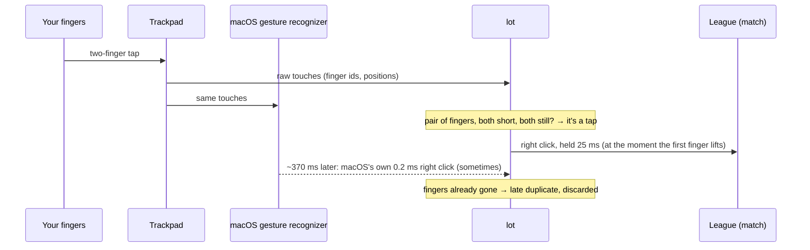

# lot — League of Trackpad

**Two-finger tap = right click in League of Legends on a MacBook trackpad.** Instantly, every time, and only while you're in a match.

If you play LoL on a Mac trackpad, you know the problem: a two-finger *tap* does nothing in-game, so you have to physically *press* the trackpad on every single move command. lot fixes that.

> *Español abajo* · [Resumen en español](#resumen-en-español)

---

## Why the game ignores your tap

I measured it. Three different problems were stacked on top of each other:

**1. The click is too short.** macOS turns a two-finger tap into a right click that lasts **0.2 ms**. The game checks the mouse once per frame and simply never sees it.


**2. It arrives late.** Even when it's caught, macOS sends the right click a median of **370 ms** after your fingers leave the trackpad, while its gesture recognizer decides whether you're tapping, zooming or about to tap again.


**3. It gets dropped.** When you tap fast, the way you do in a teamfight, macOS merges or swallows **about 1 in 3 taps**.


So stretching the click wasn't enough. lot skips macOS's tap recognizer entirely.

## How lot works



- **Reads the trackpad directly** (Apple's private `MultitouchSupport` framework, read-only) and tracks every finger by its id.
- **A tap is a pair of fingers** that landed within 150 ms of each other, touched for under 250 ms and moved less than 4 % of the pad. Overlapping fast taps still split into the right pairs.
- **Fires on the first finger lift** with a normal 25 ms right click at the cursor.
- **Filters macOS's late tap clicks** so nothing doubles. **Physical clicks pass through** untouched.
- **Only active while the match window** (`com.riotgames.LeagueofLegends.GameClient`) is in front. Lobby, browser, everything else: untouched.

The full story, with every dead end, is in **[the devlog](docs/DEVLOG.md)**.

## Install

Requires a Mac trackpad (tested on a built-in one; a Magic Trackpad should work but is untested) and the Xcode Command Line Tools (`xcode-select --install`).

```bash
git clone https://github.com/and-riu/lot_macOS.git
cd lot_macOS
./install.sh
```

Then **System Settings → Privacy & Security → Accessibility → enable `lot`**. It retries every ~30 s and starts by itself at every login.

Also recommended: **System Settings → Trackpad → Scroll & Zoom → turn off Smart Zoom.** It makes macOS wait for a possible second tap.

Logs: `~/Library/Logs/lot_macOS.log` · Uninstall: `./uninstall.sh`

Keep "Tap to click" and "Secondary click → Click or tap with two fingers" **on**. lot relies on the physical two-finger click still being a right click.

## ⚠️ Read this first

- **Anti-cheat.** lot posts synthetic right clicks (one tap = exactly one click; no macros, no automation, no game memory access). It's the same kind of input remapping as BetterTouchTool or LinearMouse, but **I can't promise Vanguard will never flag it. Use at your own risk.** If you see anti-cheat warnings, uninstall it.
- **Private API.** `MultitouchSupport` is undocumented. A macOS update could change the touch record layout (96 bytes; id @16, state @20, x/y @32/36). Tested on macOS 27.2 with a built-in trackpad.
- **Not affiliated with Riot Games or Apple.**

## Tuning

All the knobs are at the top of [`Sources/lot.swift`](Sources/lot.swift):

| constant | default | what it does |
|---|---|---|
| `maxContact` | 250 ms | longest a finger can touch and still count as a tap |
| `maxMove` | 0.04 | max movement (fraction of the trackpad); higher = more forgiving, but scrolls may turn into clicks |
| `maxSkew` | 150 ms | max time between the two fingers landing |
| `hold` | 25 ms | how long the posted right click is held |

After editing, run `./install.sh` again. Rebuilding changes the code signature, so you'll need to re-enable `lot` in Accessibility.

## Repo map

```
Sources/lot.swift     the whole program (~150 lines)
tools/clicklog.swift  the listen-only logger used to diagnose the problem
history/              every intermediate version from the devlog (comments in Spanish)
docs/DEVLOG.md        the story
```

---

## Resumen en español

**lot** («League of Trackpad») hace que el tap con dos dedos funcione como clic derecho en League of Legends en Mac, solo mientras estás en la partida.

**El problema.** Medido, no supuesto:

- El clic derecho por tap de macOS dura **0.2 ms** y el juego no lo alcanza a ver.
- Llega **~370 ms tarde**.
- Cuando das taps rápidos, macOS **se traga ~1 de cada 3**.

**La solución.** lot lee los dedos directo del trackpad. Cuando detecta un par de dedos que tocaron casi juntos, poco tiempo y sin moverse, manda el clic derecho al despegar el primer dedo. Además, descarta el clic tardío de macOS para que no salga doble. El clic físico funciona igual que siempre.

**Instalación.** Ejecuta `./install.sh` y luego activa `lot` en Ajustes → Privacidad y seguridad → Accesibilidad. También conviene apagar el Zoom inteligente en Ajustes → Trackpad.

**Aviso.** lot genera clics sintéticos: un tap es exactamente un clic, sin macros ni automatización. Aun así, no puedo garantizar que Vanguard no lo marque. Úsalo bajo tu propio riesgo.

La historia completa, con cada intento fallido, está en la [bitácora](docs/DEVLOG.md) (en inglés).

---

MIT © riu
