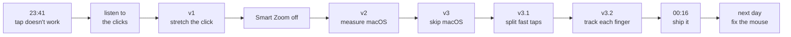
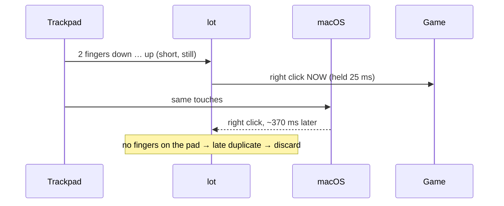
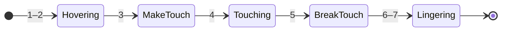
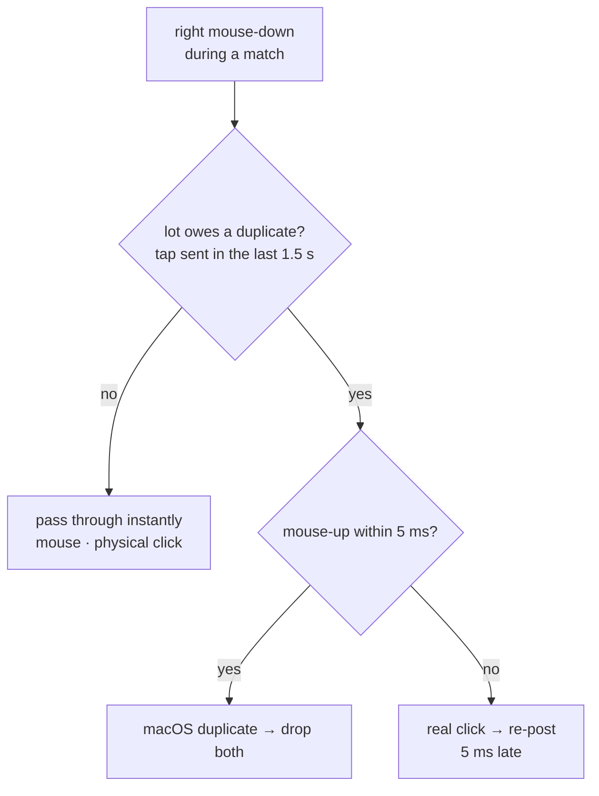

# Devlog: one night, five versions, one tap

*How "my two-finger tap doesn't work in League" turned into reading raw trackpad data at 1 a.m.*

Total time: about 35 minutes of building, most of it spent measuring. Every number below comes from logs recorded during real matches.



---

## 0 · The itch

On a MacBook, League of Legends only accepts the right click if you physically press the trackpad. A light two-finger tap, which works everywhere else in macOS, does nothing in a match.

I wanted tap-to-right-click **only while playing**, with the rest of the Mac left exactly as it is.

## 1 · "Is it even on?"

The first suspicion was that the setting was simply off. It wasn't:

```
com.apple.AppleMultitouchTrackpad
    Clicking = 1                  # tap to click: on
    TrackpadRightClick = 1        # two-finger secondary click: on
```

macOS *was* turning the tap into a right click. The game just wasn't taking it.

## 2 · Listening to the clicks

Instead of guessing, I wrote a 30-line **listen-only event tap** ([`tools/clicklog.swift`](../tools/clicklog.swift)). It prints every mouse button event with its timestamp and all 200 raw `CGEvent` fields. Then: 3 two-finger taps and 3 physical two-finger clicks.

*(First attempt: the log only had left clicks. The logger had recorded my normal clicking, not the test. Lesson: start the recording, then give the instructions.)*

The second recording was very clear. **Every field was identical except one:**

| what | mouse-down → mouse-up |
|---|---|
| two-finger **tap** (right) | **0.15 – 0.47 ms** |
| one-finger tap (left) | 1 – 5 ms |
| physical two-finger click | 280 – 345 ms |

A two-finger tap produces a right click that lasts **a fifth of a millisecond**. Games poll the mouse once per frame (every 7–16 ms). The button goes down and comes back up between two frames, so the game never sees it pressed. It's a note played so *staccato* the mic never picks it up.

## 3 · v1: stretch the click

[`history/v1_stretch.swift`](../history/v1_stretch.swift)

A `CGEventTap` that only acts when the match window is in front. When a right mouse-up arrives less than 15 ms after its mouse-down, it swallows the up and re-posts it 40 ms later.

**It worked.** Tap → champion moves. But:

> "there's a lot of latency from the moment I click until the action registers in-game"

The mouse-down was passing through instantly, so where was the delay?

## 4 · Smart Zoom was waiting for a second tap

`com.apple.trackpad.twoFingerDoubleTapGesture = 1`: **Smart Zoom** (double-tap with two fingers to zoom). With it on, every two-finger tap makes macOS wait to see if a second tap is coming before it sends anything.

Turning it off helped *a lot*. But two problems were left: still some latency, and **clicks going missing when tapping fast**.

## 5 · v2: measure macOS itself

[`history/v2_measure.swift`](../history/v2_measure.swift)

To know where time was lost, I needed to see the fingers themselves, not just the clicks. macOS has a private framework, `MultitouchSupport`, that streams raw touch frames: how many fingers are down, where, and in what state. I hooked it read-only and logged **finger lift time → right click arrival time**, in a real match.

(I also fixed a real bug in v1: if a new tap arrived before the previous stretched mouse-up was posted, the up could land *after* the new down, and the game lost a click.)

Results from 97 two-finger taps:


- Median **370 ms** from lifting your fingers to macOS sending the click, sometimes over a second.
- **35 of 97 taps (36 %) never became a click at all.** macOS's tap recognizer merges fast taps or throws them away.

So the bottleneck wasn't the game and wasn't lot. **It was the macOS tap recognizer.** No amount of click stretching fixes that.

## 6 · v3: skip macOS entirely

[`history/v3_raw_touch.swift`](../history/v3_raw_touch.swift)

New plan: detect the tap from the raw touches myself and post the right click at once.



Two tricky parts:

- **Not doubling clicks.** macOS still sends its late right click. If no fingers are touching when it arrives, it can only be a late tap-click, so it's dropped.
- **Not eating physical clicks.** What if macOS's late click lands while your fingers are already down for the *next* tap? It looks like a physical click. The tell is the mouse-up: a tap-click's up follows within ~0.2 ms, a physical click's takes 100+ ms. So lot holds the mouse-down for **5 ms**. If the up shows up, it was a late tap and both get dropped; if not, it was physical and the down gets re-posted. Physical clicks pay 5 ms; nothing else does.

> "it improved a lot, but I feel it can get better, some clicks are still missing"

The log said: 32 clicks, 6 ignored. All 6 had a strange "movement" of 0.13–0.27 (a real tap moves ~0.01).

## 7 · v3.1: fast taps overlap

[`history/v3_1_phases.swift`](../history/v3_1_phases.swift)

That "movement" wasn't movement. It was **two taps merging into one**. When you tap fast, one finger of the first tap is still lifting when the next tap lands:

```
finger A  ███████░
finger B   ████████░
finger C          ███████
finger D           ██████
fingers   1 2 2 2 2 1 2 2 1 0
          └─ tap 1 ─┘└ tap 2 ┘
```

v3 waited for *all* fingers to lift, so it saw one long touch whose center jumped from tap 1 to tap 2. It looked like a scroll, got ignored, and **both** taps were lost.

Fix: judge each **two-finger phase** separately and fire the click when the **first** finger lifts. That also shaved a few more milliseconds off the latency.

Then a tap-happy test match: 122 clicks, 75 ignored. Two new causes:

- **"3rd finger" (33):** taps so fast that *three* fingers were touching at once (2 → 3), which broke the two-finger phase.
- **"Movement" (~42):** short, still taps reported with movement of 0.05–0.2.

## 8 · v3.2: follow each finger, not the count

Final version: [`Sources/lot.swift`](../Sources/lot.swift)

The fix for both was the same: **stop counting fingers and follow each one.** Every touch in the raw stream has an **id** and a **state**:



The ghost "movement" came from fingers in states 1–2 and 5–7, hovering just above the glass or peeling off it, whose positions jump around. Real contact is only states **3 and 4**, and positions are reliable only in 4.

So v3.2 tracks every finger by id, from touch-down to lift. **A tap is a pair of fingers** that:

- landed **within 150 ms** of each other,
- each touched for **under 250 ms**,
- each moved **less than 4 %** of the pad.

When a finger lifts and has a valid partner, that's a tap: click, mark both as used. Four fingers from two overlapping taps now split cleanly into two pairs.

> "it turned out excellent"

## 9 · Shipping it

- A `LaunchAgent` starts lot at login and restarts it if it dies.
- It needs **Accessibility** permission, because it modifies and posts mouse events. Reading the trackpad needs nothing extra.
- Rebuilding changes the binary's signature, and macOS then forgets the permission. Every rebuild means re-ticking the box.

## 10 · The bug I shipped: "my mouse doesn't work"

A few hours after "excellent", with the repo already up as private:

> "I need you to turn the script off right now, my connected mouse doesn't work"

Only inside the match. The cause was the duplicate filter from v3. Its rule was *"a right click with no fingers on the trackpad must be macOS's late tap-click, so drop it."* An external mouse fits that rule perfectly: no fingers on the trackpad. **Every right click from the mouse was being thrown away.** It was a rule that held for the only device I tested with and was wrong in general.

The fix: lot no longer guesses from what's missing. It keeps a count of what it's **owed**.

- Every tap lot sends adds one *owed* duplicate, valid for 1.5 s (macOS's late clicks arrived within ~1.1 s).
- With nothing owed, **every right click passes through instantly**: mouse, physical click, anything.
- With something owed, the mouse-down is held for 5 ms. If its mouse-up arrives inside that window (a duplicate's comes ~0.2 ms later), it's the duplicate and both get dropped. If not, it's a real click and it's re-posted.



An external mouse only ever pays those 5 ms when you click it right after a trackpad tap.

## What I'd tell someone trying something similar

1. **Measure before fixing.** A 30-line logger showed in two minutes what an hour of guessing wouldn't have.
2. **Log in the real setting.** The overlapping-taps problem only appears when you tap the way you actually play.
3. **"Movement" in a sensor isn't always movement.** Check what state the data is in before trusting it.
4. **When the platform is the bottleneck, step around it,** but keep a door open for what it still does well (physical clicks).
5. **Filter by what you know, not by what's missing.** "No fingers on the trackpad" didn't mean "late tap". It also meant "mouse". Keeping track of what you're owed beats guessing.

---

*Built in one night (plus one morning-after fix) with [Claude Code](https://claude.com/claude-code).*
